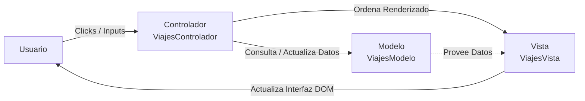

# 🌍 PaniViajes — Plataforma Web de Destinos Turísticos


Proyecto práctico desarrollado para el módulo profesional **Desarrollo Web en Entorno Cliente (0612)**, correspondiente al Ciclo Formativo de Grado Superior en **Desarrollo de Aplicaciones Web (DAW)** — Núcleo Formativo 2 (NF2 / RA4).

---

## 📌 Descripción del Proyecto

**PaniViajes** es una aplicación web interactiva de gestión y visualización de viajes que implementa una arquitectura orientada a objetos bajo el **patrón de diseño MVC (Modelo - Vista - Controlador)**. 

La aplicación permite la identificación del usuario, despliega un carrusel dinámico de navegación circular con 6 destinos internacionales y calcula automáticamente la participación en un sorteo de descuentos acumulativo en función del historial de visitas persistido en el navegador.

---

## ✨ Características Principales

- **Interacción y Bienvenida Personalizada**: Validación y captura del nombre de usuario al inicio de la sesión, ocultando el formulario de acceso y mostrando la interfaz principal de forma reactiva.
- **Carrusel de Destinos Circular**: Visualización interactiva de 6 destinos turísticos con navegación bidireccional infinita (anterior/siguiente), mostrando fotografía, nombre, precio y contador dinámico de posición (`Destino X de Y`).
- **Persistencia de Visitas (`localStorage`)**: Conteo acumulativo de visitas persistido en el almacenamiento local del cliente web entre recargas y sesiones.
- **Motor de Sorteo y Descuentos**: Algoritmo de probabilidad condicional:
  - Generación de número aleatorio entre 1 y el total de visitas.
  - Verificación de elegibilidad (visitas superiores a 100 y coincidencia con el aleatorio).
  - Elección aleatoria del destino premiado y cálculo matemático del 15% de descuento sobre el precio base.

---

## 🏗️ Arquitectura del Software (Patrón MVC)

El proyecto está diseñado de forma modular mediante **Clases ES6+**, separando estrictamente la capa de datos, la interfaz de usuario y la orquestación de eventos:



### 1. Modelo (`ViajesModelo`)
- Encapsula los arrays de datos: destinos, rutas de imágenes y tarifas.
- Controla el puntero de navegación circular (`indiceActual`).
- Gestiona el almacenamiento local (`localStorage`) para registrar visitas.
- Ejecuta la lógica matemática del sorteo y cálculo de descuentos.

### 2. Vista (`ViajesVista`)
- Mapea las referencias a los elementos del DOM (`document.getElementById`).
- Actualiza el contenido visual del carrusel (imágenes, textos, precios y contador).
- Gestiona la visibilidad de las capas mediante manipulación de clases CSS (`.oculto`).
- Renderiza los mensajes del resultado del sorteo.

### 3. Controlador (`ViajesControlador`)
- Actúa como intermediario desacoplado entre el Modelo y la Vista.
- Suscribe y gestiona los escuchadores de eventos (`addEventListener`) para las acciones del usuario (login, flecha anterior, flecha siguiente).

---

## 📁 Estructura del Repositorio

```text
UF2/
├── imagen/              # Recursos gráficos de los destinos turísticos
│   ├── china.jpg
│   ├── coreasur.jpg
│   ├── india.jpg
│   ├── japon.jpg
│   ├── tailandia.jpg
│   └── vietnam.jpg
├── viajes.html          # Estructura semántica del documento web
├── viajes.css           # Hoja de estilos (diseño limpio y responsive)
├── viajes.js            # Lógica completa de la aplicación (Clases y MVC)
└── README.md            # Documentación técnica del proyecto
```

---

## 🚀 Puesta en Marcha

No se requieren dependencias externas ni servidores complejos:

1. **Clonar el repositorio:**
   ```bash
   git clone https://github.com/mpaniselloc/Desarrollo-Entorno-Cliente-IFP.git
   ```
2. **Acceder al directorio:**
   ```bash
   cd Desarrollo-Entorno-Cliente-IFP/UF2
   ```
3. **Ejecutar la aplicación:**
   - Abre directamente el archivo `viajes.html` con cualquier navegador moderno (Google Chrome, Mozilla Firefox, Microsoft Edge, Safari) o mediante la extensión *Live Server* de Visual Studio Code.

---

## 🧪 Pruebas de Funcionamiento

- **Navegación**: Al pulsar `❮` o `❯`, el carrusel avanza y retrocede continuamente de manera circular entre los 6 destinos.
- **Simular Sorteo en Consola (F12)**: Para forzar la condición de más de 100 visitas y verificar el mensaje de descuento, puedes ejecutar en la consola del navegador:
  ```javascript
  localStorage.setItem("visitasViajes", 100);
  ```

---

## 👨‍💻 Autor

- **Alumno**: Marc Panisello
- **Curso**: Ciclo Formativo de Grado Superior en Desarrollo de Aplicaciones Web (DAW)
- **Módulo**: Desarrollo Web en Entorno Cliente (0612)
